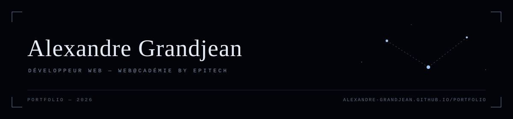

Junior web developer at **web@cadémie by Epitech**, looking for an apprenticeship
(alternance) in Île-de-France.

I'd rather open the box than use it. That's why I build small, finished things
instead of collecting tutorials.

### Selected work

- **[Passlock](https://github.com/Alexandre-grandjean/Passlock)** — Local-first password
  manager in Rust. No account, no server, no telemetry: you own the vault file, the key
  and the format.
- **[Portfolio](https://alexandre-grandjean.github.io/portfolio/)** — A star map you
  navigate by clicking. Astro + three.js.
- **[Apprendre le dev](https://alexandre-grandjean.github.io/apprendre-le-dev/)** — Six
  modules that take you from an HTTP request to JWT auth. Next.js + MDX.

### Elsewhere

[Portfolio](https://alexandre-grandjean.github.io/portfolio/) ·
[LinkedIn](https://www.linkedin.com/in/alexandre-grandjean-pro) ·
[alexandre.grandjean@epitech.eu](mailto:alexandre.grandjean@epitech.eu)
